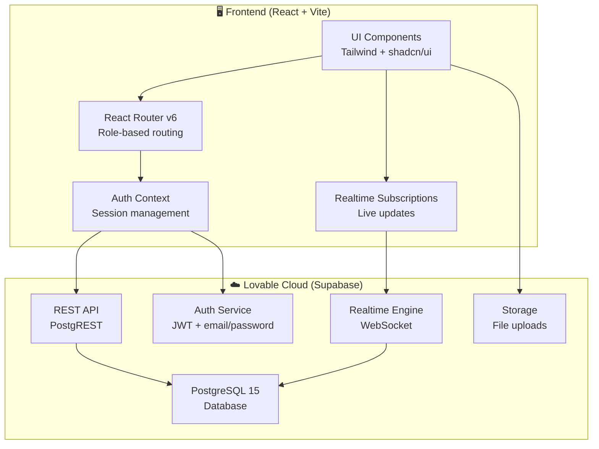
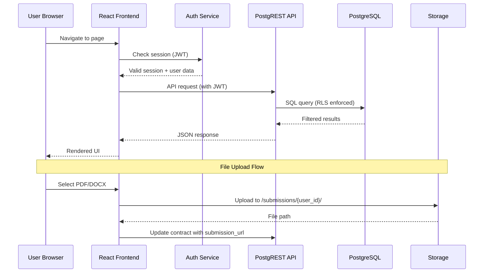
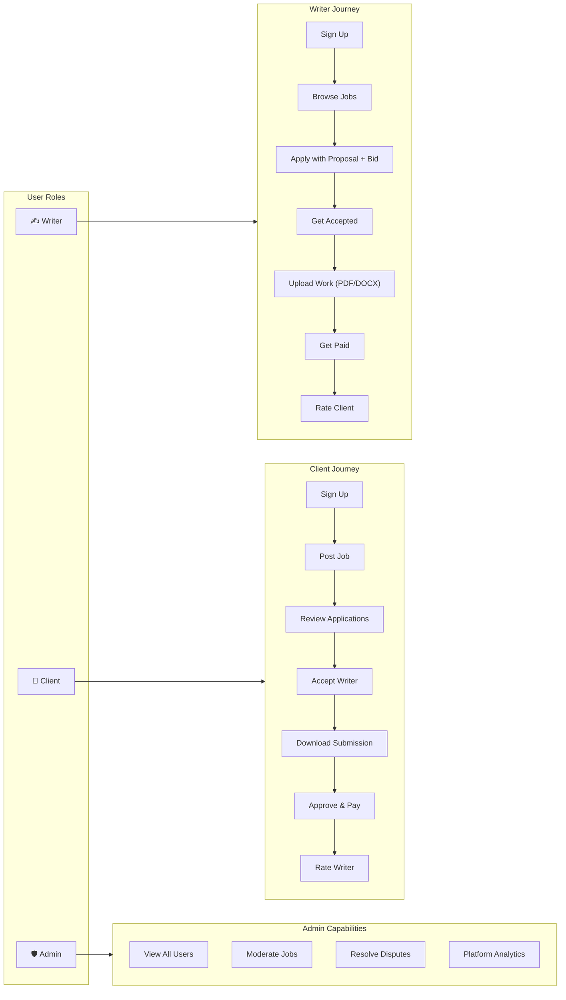
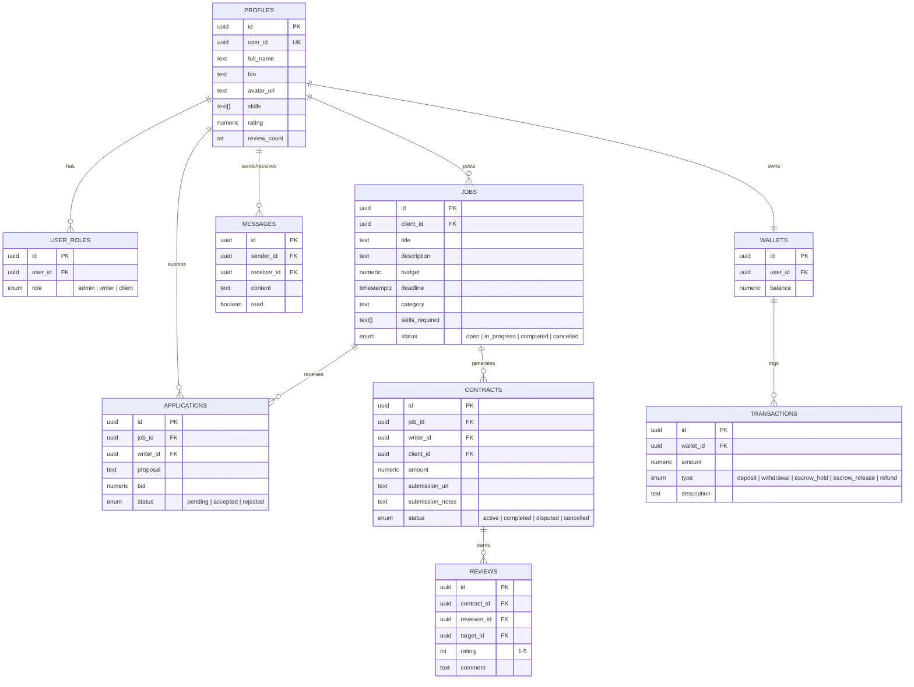
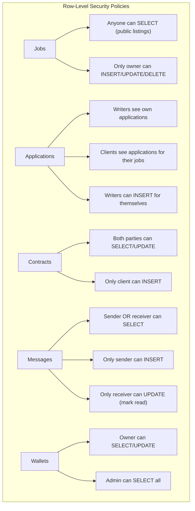
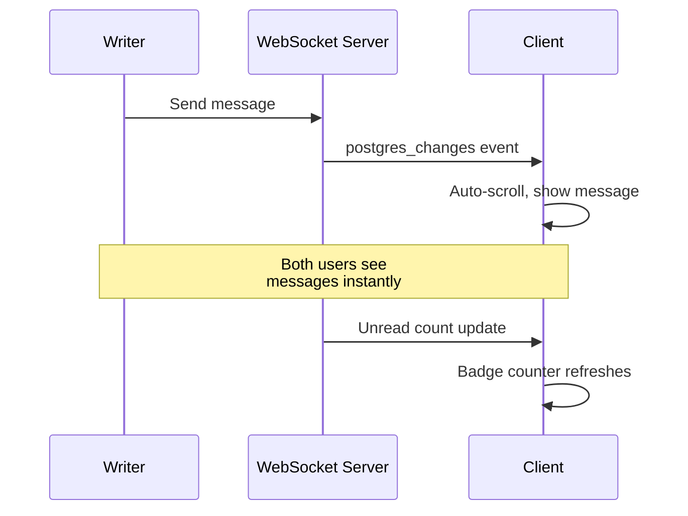

<p align="center">
  
</p>

<h1 align="center">🖋️ InkBridge</h1>
<p align="center"><strong>A trusted freelance writing marketplace connecting clients with talented writers.</strong></p>
<p align="center">
  
  
  
  
  
</p>

---

## 📋 Table of Contents

- [Overview](#-overview)
- [Architecture](#-architecture)
- [User Roles & Flows](#-user-roles--flows)
- [Features](#-features)
- [Database Schema](#-database-schema)
- [Security Model](#-security-model)
- [Real-Time Capabilities](#-real-time-capabilities)
- [File Storage](#-file-storage)
- [Performance & Scalability](#-performance--scalability)
- [Tech Stack](#-tech-stack)
- [Getting Started](#-getting-started)
- [Project Structure](#-project-structure)
- [API Rate Limits & Capacity](#-api-rate-limits--capacity)

---

## 🌐 Overview

**InkBridge** is a production-ready freelance writing marketplace where:

- **Clients** post writing jobs with budgets and deadlines
- **Writers** browse, search, and apply to jobs with proposals and bids
- **Work** is submitted through the platform via secure file uploads (PDF/DOCX)
- **Payments** are handled through a wallet & escrow simulation system
- **Both parties** rate and review each other after project completion
- **Admins** moderate the platform, resolve disputes, and view analytics

---

## 🏗️ Architecture



### Request Flow



---

## 👤 User Roles & Flows



### Role Assignment

| Role     | Assignment Method                         | Access Level                              |
|----------|-------------------------------------------|-------------------------------------------|
| `writer` | Selected during signup                    | Browse/apply to jobs, submit work, wallet |
| `client` | Selected during signup                    | Post jobs, manage applicants, download    |
| `admin`  | Manually assigned in `user_roles` table   | Full platform oversight                   |

---

## ✨ Features

### Client Features
| Feature | Description | Status |
|---------|-------------|--------|
| Post Jobs | Title, description, budget, deadline, category, required skills | ✅ |
| View Applicants | See all proposals with bids and writer profiles | ✅ |
| Accept/Reject Writers | One-click accept creates a contract; others auto-rejected | ✅ |
| Download Submissions | Download uploaded PDF/DOCX files | ✅ |
| Direct Messaging | Real-time chat with writers | ✅ |
| Wallet System | Track balance and transactions | ✅ |

### Writer Features
| Feature | Description | Status |
|---------|-------------|--------|
| Browse & Search Jobs | Filter by category, skills, budget | ✅ |
| Apply to Jobs | Submit proposal text + bid amount | ✅ |
| Upload Work | Submit PDF or DOCX (up to 10MB) | ✅ |
| Track Applications | View status of all applications | ✅ |
| Earnings Dashboard | View wallet balance and transaction history | ✅ |
| Direct Messaging | Real-time chat with clients | ✅ |

### Admin Features
| Feature | Description | Status |
|---------|-------------|--------|
| User Management | View all users, roles, ratings | ✅ |
| Job Moderation | Cancel inappropriate or stale jobs | ✅ |
| Dispute Resolution | Release payment or refund on disputed contracts | ✅ |
| Platform Analytics | Total users, jobs, active contracts, disputes | ✅ |

### Messaging System
| Feature | Description |
|---------|-------------|
| Real-time delivery | Messages appear instantly via WebSocket |
| Conversation list | Grouped by user with latest message preview |
| Unread badge | Live unread count in dashboard headers |
| Mark as read | Auto-marks messages when conversation is opened |
| Direct links | Message Writer/Client buttons on contracts and applications |

---

## 🗄️ Database Schema



### Enums

| Enum | Values |
|------|--------|
| `app_role` | `admin`, `writer`, `client` |
| `application_status` | `pending`, `accepted`, `rejected` |
| `contract_status` | `active`, `completed`, `disputed`, `cancelled` |
| `job_status` | `open`, `in_progress`, `completed`, `cancelled` |
| `transaction_type` | `deposit`, `withdrawal`, `escrow_hold`, `escrow_release`, `refund` |

---

## 🔒 Security Model

### Row-Level Security (RLS)

Every table has RLS enabled with policies that enforce access at the database level:



### Authentication Flow

| Step | Description |
|------|-------------|
| 1. Signup | Email + password + role selection → creates `auth.user` |
| 2. Profile | Trigger auto-creates `profiles` and `wallets` rows |
| 3. Role | User role stored in `user_roles` (separate from profile) |
| 4. Session | JWT stored in localStorage with auto-refresh |
| 5. Access | Every API call includes JWT; RLS policies enforce access |

### Security Features

- ✅ **JWT-based authentication** with automatic token refresh
- ✅ **Role-based access control** using `has_role()` security definer function
- ✅ **RLS on every table** — no data leaks even with direct API access
- ✅ **Separate roles table** — prevents privilege escalation
- ✅ **File upload validation** — PDF/DOCX only, 10MB limit
- ✅ **Protected routes** — client-side route guards with role verification

---

## ⚡ Real-Time Capabilities

InkBridge uses Supabase Realtime (WebSocket-based) for live updates:



| Feature | Channel | Event |
|---------|---------|-------|
| New messages | `messages` | `INSERT` on `public.messages` |
| Message read status | `messages` | `UPDATE` on `public.messages` |
| Unread count badge | `unread-count` | `INSERT` on `public.messages` filtered by `receiver_id` |

---

## 📁 File Storage

### Submissions Bucket

| Property | Value |
|----------|-------|
| Bucket name | `submissions` |
| Public access | No (authenticated only) |
| Max file size | 10 MB |
| Allowed types | PDF, DOCX |
| Path format | `{user_id}/{contract_id}.{ext}` |

### Storage Policies

| Policy | Action | Condition |
|--------|--------|-----------|
| Writers can upload | INSERT | Folder matches `auth.uid()` |
| All authenticated can view | SELECT | Authenticated user |
| Writers can update own | UPDATE | Folder matches `auth.uid()` |

---

## 📊 Performance & Scalability

### API Rate Limits & Capacity

| Metric | Free Tier | Pro Tier |
|--------|-----------|----------|
| API requests | 500/min | 1,000/min |
| Realtime connections | 200 concurrent | 500 concurrent |
| Database size | 500 MB | 8 GB |
| Storage | 1 GB | 100 GB |
| Bandwidth | 2 GB/month | 250 GB/month |
| Max rows returned | 1,000/query | 1,000/query (configurable) |

### Concurrent Users

| Load Level | Users | Expected Behavior |
|------------|-------|--------------------|
| Low | 1–50 | Instant responses, < 100ms |
| Medium | 50–200 | Slight latency on complex queries |
| High | 200–500 | May hit realtime connection limits on free tier |
| Scale | 500+ | Requires Pro tier + connection pooling |

### Optimization Strategies

| Strategy | Implementation |
|----------|---------------|
| Query batching | `Promise.all()` for parallel API calls |
| Selective fetching | Only load needed columns with `.select()` |
| Pagination | `.range()` for large result sets |
| Realtime filtering | Server-side filter on `receiver_id` |
| Client caching | React state for session-level cache |
| Lazy loading | Route-based code splitting via React Router |

---

## 🛠️ Tech Stack

| Layer | Technology | Purpose |
|-------|-----------|---------|
| **Frontend** | React 18 | UI framework |
| **Language** | TypeScript 5 | Type safety |
| **Build** | Vite 5 | Fast dev server & bundling |
| **Styling** | Tailwind CSS 3 | Utility-first CSS |
| **Components** | shadcn/ui | Accessible component library |
| **Animations** | Framer Motion | Smooth page transitions |
| **Icons** | Lucide React | Consistent iconography |
| **Routing** | React Router 6 | Client-side routing |
| **Backend** | Supabase (Lovable Cloud) | Auth, DB, Storage, Realtime |
| **Database** | PostgreSQL 15 | Relational data store |
| **Auth** | Supabase Auth | JWT-based authentication |
| **Storage** | Supabase Storage | File uploads |
| **Realtime** | Supabase Realtime | WebSocket live updates |
| **Notifications** | Sonner | Toast notifications |

---

## 🚀 Getting Started

### Prerequisites

- Node.js 18+ or Bun
- A Lovable account (backend is auto-provisioned)

### Installation

```bash
# Clone the repository
git clone <repository-url>
cd inkbridge

# Install dependencies
npm install
# or
bun install

# Start the development server
npm run dev
# or
bun dev
```

The app will be available at `http://localhost:5173`.

### Environment Variables

The following are auto-configured by Lovable Cloud:

| Variable | Description |
|----------|-------------|
| `VITE_SUPABASE_URL` | Backend API URL |
| `VITE_SUPABASE_PUBLISHABLE_KEY` | Public API key |

### Test Accounts

To test the full flow:

1. **Sign up as a Client** — post a job
2. **Sign up as a Writer** (different email) — apply to the job
3. **Log in as Client** — accept the writer, view the contract
4. **Log in as Writer** — upload a submission (PDF/DOCX)
5. **Log in as Client** — download the submission

---

## 📂 Project Structure

```
inkbridge/
├── public/                     # Static assets
├── src/
│   ├── components/
│   │   ├── landing/            # Landing page sections
│   │   │   ├── CTASection.tsx
│   │   │   ├── FeaturesSection.tsx
│   │   │   ├── Footer.tsx
│   │   │   ├── HeroSection.tsx
│   │   │   └── Navbar.tsx
│   │   ├── ui/                 # shadcn/ui components (40+ components)
│   │   ├── NavLink.tsx
│   │   └── ProtectedRoute.tsx  # Role-based route guard
│   ├── contexts/
│   │   └── AuthContext.tsx      # Authentication state management
│   ├── hooks/
│   │   ├── use-mobile.tsx       # Responsive breakpoint hook
│   │   ├── use-toast.ts         # Toast notification hook
│   │   └── useUnreadMessages.ts # Realtime unread count
│   ├── integrations/
│   │   └── supabase/
│   │       ├── client.ts        # Auto-generated Supabase client
│   │       └── types.ts         # Auto-generated database types
│   ├── pages/
│   │   ├── dashboard/
│   │   │   ├── AdminDashboard.tsx
│   │   │   ├── ClientDashboard.tsx
│   │   │   ├── ClientJobDetail.tsx
│   │   │   └── WriterDashboard.tsx
│   │   ├── HowItWorks.tsx
│   │   ├── Index.tsx            # Landing page
│   │   ├── JobDetail.tsx        # Public job view + apply
│   │   ├── Jobs.tsx             # Job listings
│   │   ├── Login.tsx
│   │   ├── Messages.tsx         # Real-time chat
│   │   ├── NotFound.tsx
│   │   └── Signup.tsx
│   ├── App.tsx                  # Route definitions
│   ├── index.css                # Design tokens & global styles
│   └── main.tsx                 # App entry point
├── supabase/
│   ├── config.toml              # Supabase project config
│   └── migrations/              # Database migration files
├── tailwind.config.ts           # Tailwind theme configuration
├── vite.config.ts               # Vite build configuration
└── package.json
```

---

## 📐 Design System

### Color Palette

| Token | HSL | Usage |
|-------|-----|-------|
| `--background` | 222 47% 6% | Page backgrounds |
| `--foreground` | 210 40% 98% | Primary text |
| `--primary` | 222 47% 20% | Buttons, headers |
| `--accent` | 142 71% 45% | Green highlights, CTAs |
| `--muted` | 217 33% 17% | Subtle backgrounds |
| `--destructive` | 0 84% 60% | Error states, rejections |

### Typography

| Element | Font | Weight |
|---------|------|--------|
| Headings | `font-heading` (Merriweather) | Bold (700) |
| Body | System sans-serif | Regular (400) |

---

<p align="center">
  <strong>Built with ❤️ using Lovable</strong><br/>
  <em>Making freelance writing trustworthy and transparent.</em>
</p>
